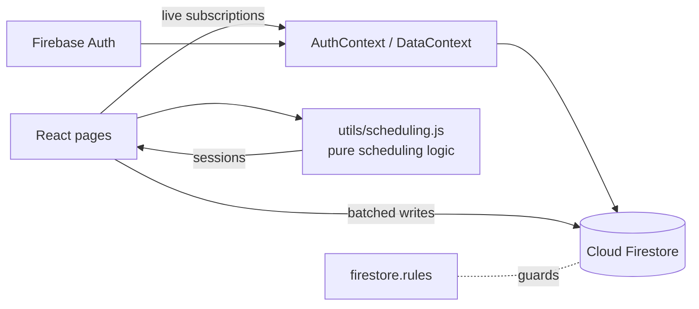

# Hospital Therapy Scheduler

A therapy scheduling system built for a rehabilitation hospital. Staff generate daily or weekly timetables for patients across physiotherapy, occupational therapy, speech, VR, robotic and psychology sessions, while the app keeps doctors, patients and equipment from being double-booked.

**Live app:** https://hospital-scheduler-c7365.web.app

<!--
  Add screenshots here once you have taken them, e.g.:
  
  
-->

## Features

**Scheduling**
- One-click schedule for a day or a week, built from the hours and per-therapy session lengths set in *Time Config*
- Never double-books a doctor, a patient or a piece of equipment; honours doctor leave (full day, morning or afternoon) and closed days
- Patients can need 1, 2 or 3 sessions per therapy per day, spread across the day
- Recurring plans ("physio on Mon/Wed/Fri for 4 weeks") with a preview before saving
- Manual add / edit / drag-and-drop with a clash warning before anything is saved
- Marking a doctor unavailable or on leave offers to move their sessions to a free colleague

**Daily use**
- Live dashboard: today's sessions, who is next, doctor workload, patients with no session
- Timetable grid (doctors as columns, time as rows); drag a session to move it
- Session status: scheduled / attended / missed / cancelled, with one-click reschedule for missed ones
- Printable sheets per doctor or per patient (print or save as PDF)
- WhatsApp reminder message for a patient, ready to send
- Excel export for any date range

**Reports**
- Doctor utilization, attendance and missed-session rate, sessions per therapy per week

**Platform**
- Staff sign-in with **five roles** (admin, scheduling staff, doctor, reception, manager), created by the admin from inside the app and enforced by Firestore security rules (see *Roles* below)
- Live updates: when one person changes something, everyone sees it without refreshing
- Responsive layout, installable on a phone (PWA)

## Roles

| | Admin | Scheduling staff | Doctor / Therapist | Reception | Manager |
|---|:-:|:-:|:-:|:-:|:-:|
| Dashboard | ✔ | ✔ | own sessions | ✔ | ✔ |
| Timetable, Print & Share | ✔ | ✔ | own only | ✔ | – |
| Check-in (attended / missed) | ✔ | ✔ | own only | ✔ | – |
| Generate / edit / move / cancel sessions, recurring plans | ✔ | ✔ | – | – | – |
| Register and edit patients | ✔ | ✔ | – | – | – |
| Delete patients | ✔ | – | – | – | – |
| Patient phone numbers, WhatsApp | ✔ | ✔ | – | ✔ | – |
| Doctor leave and availability | ✔ | ✔ | own leave | – | – |
| Add / delete doctors and equipment | ✔ | – | – | – | – |
| Reports and Excel export | ✔ | ✔ | – | – | ✔ |
| Time Config, Users & Roles | ✔ | – | – | – | – |

Logins are created on the **Users & Roles** page. The new person gets an email to choose their own password. The rules in `firestore.rules` enforce all of this on the server, so hiding a button is never the only protection.

## Tech stack

React 18 (Create React App) · Firebase Authentication · Cloud Firestore · Firebase Hosting · React Router · ExcelJS · date-fns

## How it works



All scheduling decisions (slot generation, clash detection, equipment, leave, plans, reports) live in `src/utils` as plain functions with no Firebase or React in them, so they can be unit-tested.

### Firestore data

| Collection | Document fields |
|---|---|
| `users/{uid}` | `name`, `email`, `role` (`admin` / `scheduler` / `doctor` / `reception` / `manager`), `active`, `doctorId` (doctors only). Managed from the Users & Roles page; the first admin is created by hand |
| `doctors` | `name`, `therapy`, `available`, `leave: [{ date: "yyyy-MM-dd", part: "full" \| "am" \| "pm" }]` |
| `patients` | `name`, `therapies[]`, `therapySlots{therapy: 1-3}`, `assignedDoctors{therapy: doctorId}` |
| `patientContacts/{patientId}` | `phone` (separate so managers and doctors cannot read it) |
| `equipment` | `name`, `therapy`, `available` |
| `schedule` | `patientId`, `patientName` (copied so doctors, who cannot read patients, still see it), `doctorId`, `therapy`, `startTime` (ISO), `duration` (min), `equipmentId`, `status`, `planId?`, `rescheduledFrom?` |
| `config/timeslots` | `default: [{start, end}]`, `tuesday: [{start, end}]`, `closedDays[]`, `durations{therapy: minutes}` |

## Getting started

```bash
npm install
npm start          # http://localhost:3000
npm test           # unit tests + screen tests (no network needed)
npm run build      # production build into build/
```

### One-time Firebase setup
1. **Authentication → Sign-in method:** enable *Email/Password*.
2. **Authentication → Users:** add yourself (email + password) and copy your **User UID**.
3. **Firestore → Start collection `users`:** one document, **Document ID = your UID**, with a string field `role` set to `admin`. This is the only login created by hand; everyone else is added from the **Users & Roles** page.
4. Deploy the rules and indexes, then the app:

```bash
firebase deploy --only firestore:rules,firestore:indexes
npm run build
firebase deploy --only hosting
```

## Project structure

```
src/
  context/     AuthContext (sign-in + role), DataContext (live Firestore data)
  hooks/       useSessionOps (edit / status / reschedule with clash checks)
  utils/       scheduling.js, permissions.js, reports.js, plans.js, share.js, timeUtils.js  <- pure logic + tests
  components/  one file per page (Dashboard, Timetable, Scheduler, ...)
  __tests__/   screen tests with Firebase stubbed out
firestore.rules   role-based security rules
firestore.indexes.json   the one extra index doctor logins need
public/           manifest.json + sw.js (installable app)
```

## Author

Nasmal Naseer: designed and built during a web developer internship at a rehabilitation hospital.
